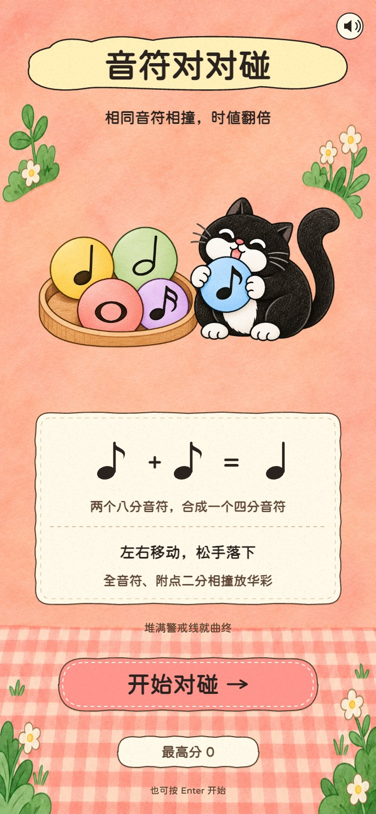
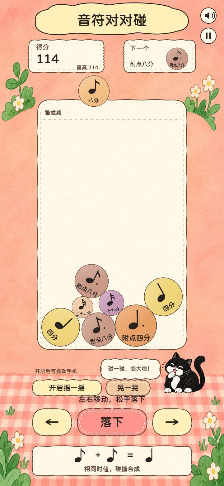

# 音符对对碰 · 小猫绘本版

桃粉水彩、奶油纸卡、黑白小猫与野餐格纹界面，按 720×1558 竖屏画布显示。球采用九种独立暖色并标注时值名称，游戏半径为原版的 90%，显示和碰撞共用半径。

直接打开 `index.html` 可离线游玩，插画、猫啃糖圆体和原有音频均已内嵌；字体许可见 `assets/font-LICENSE.txt`。左右拖动、松手落下，也可使用方向与落下按钮；键盘方向键移动，空格落下，P 暂停，M 开关声音。

## 音符与合成

已移除附点十六分音符，当前有九种时值。普通分支为三十二分→十六分→八分→四分→二分→全音符；附点分支为附点八分→附点四分→附点二分。初始掉落从三十二分、十六分、八分、附点八分中等概率选择，使剩下的附点分支仍可合成。

同类球边缘接触允许 8 个画布像素余量，新合成的球可立即参加连锁，每个球每轮只消耗一次。不同种类保持物理碰撞，两颗附点二分触发“附点华彩”，两颗全音符触发“华彩”，均消除这一对并获得 66 基础分，连奏倍数继续生效。各保留时值的合成目标、原计分、连奏、最高分存储键和宿主接口保留。

## 摇一摇

进入游戏后点「开启摇一摇」，若浏览器询问动作感应权限，选择允许；再次点「摇一摇：开」可关闭。默认不启用感应，授权由手指松开按钮的事件直接发起。没有权限、没有传感器数据或在电脑游玩时，可用旁边的「晃一晃」。

晃动使球明显弹起并交错移动，同类球会受到向最近同类靠拢的横向推力，再由碰撞系统合成，不直接加分。触发阈值为 5 m/s²，生效至少间隔 0.32 秒；横向速度上限 820，向上速度上限 1000，实际抛起幅度按警戒线下的可用空间限制。暂停、结束与后台不响应，静态重力会被过滤。

## 验证与素材

已验证九种时值各自正确倍增，保留原计分，四种初始掉落均可出现；附点十六分从实际游戏、掉落和素材导出中移除。动作与权限模拟检查、轻擦边界、立即连锁、三球接触不重复计分、静止重力、开启关闭、拒绝/异常/无接口/无数据，以及暂停/结束/后台限制均通过。Chrome/WebKit 的离线打开、开始、下落，Chrome 的移动、拖放、静音、重开与存档检查通过。

模拟结果不代表真实手机灵敏度或课堂验收，仍需真机试玩。小猫与场景为参考课件风格生成的独立插画，文字、音符和交互由 Canvas 绘制；内嵌素材保持原 data-only CSP 与单文件离线能力。从 DSH 再次导出可能覆盖此 HTML，请保留改版提交。

浏览器接口依据：[动作感应与授权](https://developer.mozilla.org/en-US/docs/Web/API/DeviceMotionEvent/requestPermission_static)、[含重力加速度](https://developer.mozilla.org/en-US/docs/Web/API/DeviceMotionEvent/accelerationIncludingGravity)。

## 实际运行画面

